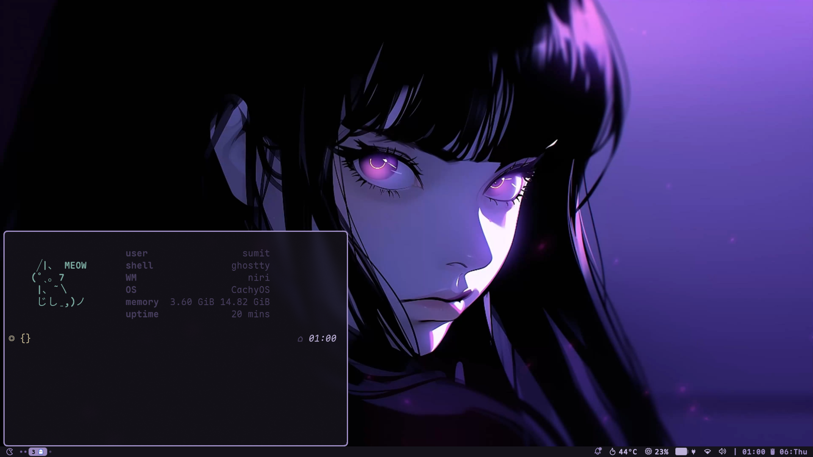

# yesto hunxa : )



## Install

CachyOS. Clone this repo, then run the script from a logged-in session so it can enable user services.

```bash
git clone git@github.com:sumit-poudel/dotfiles.git ~/.dotfiles
cd ~/.dotfiles
./install.sh
```

`./install.sh --noconfirm` passes `--noconfirm` through to pacman and paru.

The script:

- Installs the package list with pacman, drivers with `chwd`, and the AUR packages with paru. That step runs on CachyOS only.
- Sets fish as the login shell when `/etc/shells` already lists it.
- Copies `.config/` into `~/.config`, the root dotfiles (`.zshrc`, `.zshenv`, `.vimrc`, `.tmux.conf`, `.zsh_plugins.txt`) into `$HOME`, `wallpapers/` into `~/Pictures/Wallpapers`, and `avtar.jpg` into `~/Pictures/avtar.jpg`. An existing file, directory, or symlink is moved to the same path with a `.bck` suffix first.
- Installs fisher plugins from `~/.config/fish/fisher.list`, the yazi recycle-bin plugin, tmux plugins, and [nvim](https://github.com/sumit-poudel/nvim.git).
- Enables and starts the user services `foot-server`, `mpd`, and `mpd-mpris`.

Apps read the real files under `~/.config`. Noctalia rewrites its theme files there. Those generated themes, plus MPD's database and logs, stay out of git.
